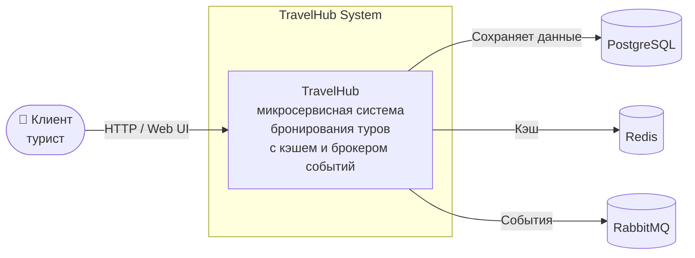
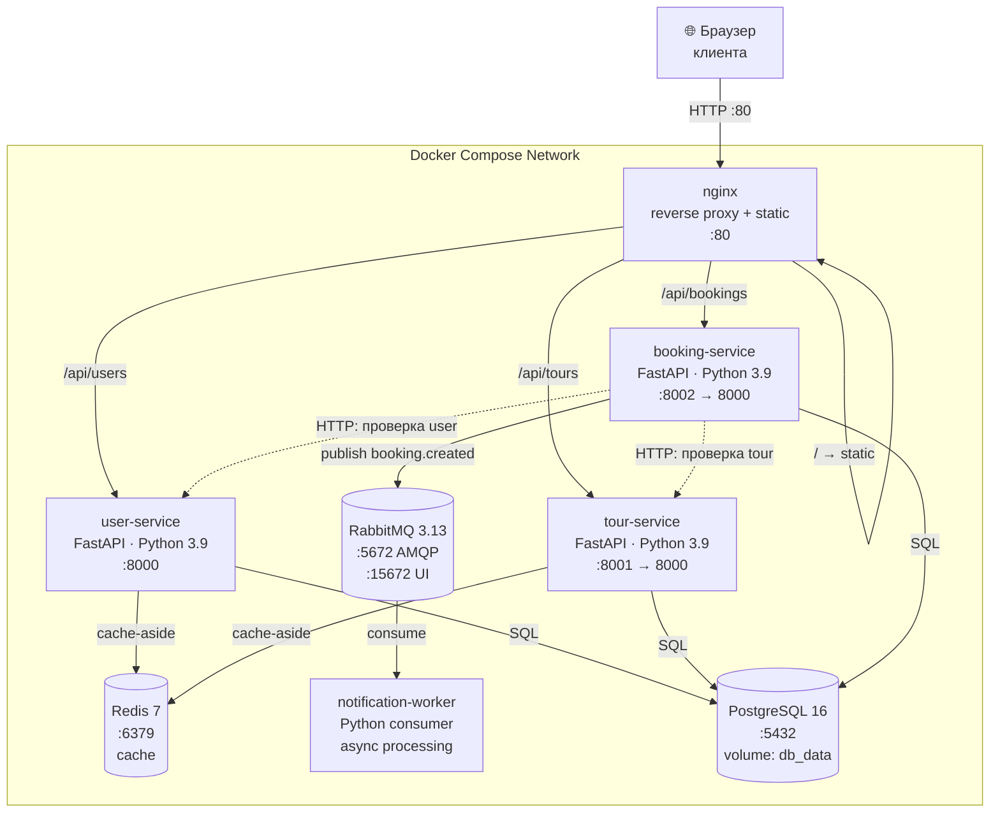

# TravelHub — Архитектура (C4)

Документ описывает архитектуру системы TravelHub по трём уровням модели C4:
**Context**, **Container**, **Component**.

---

## Уровень 1: Context (System Context)

Показывает систему в её окружении — кто её использует и какие внешние системы с ней связаны.



**Что происходит:**

- Клиент (человек) открывает Web UI в браузере
- Web UI обращается к API системы TravelHub
- Система кэширует горячие данные в Redis
- Система хранит постоянные данные в PostgreSQL
- Система публикует события в RabbitMQ для асинхронной обработки

---

## Уровень 2: Container

Показывает высокоуровневые технические компоненты системы — сервисы, базы данных, кэш, брокер, frontend, reverse proxy.



**Контейнеры:**

| Контейнер | Технология | Порт | Назначение |
|---|---|---|---|
| **nginx** | nginx:1.27-alpine | 80 | Reverse proxy + раздача статики фронтенда |
| **user-service** | FastAPI + Uvicorn, Python 3.9 | 8000 | CRUD пользователей + cache-aside с Redis |
| **tour-service** | FastAPI + Uvicorn, Python 3.9 | 8001 → 8000 | CRUD туров + cache-aside с Redis |
| **booking-service** | FastAPI + Uvicorn, Python 3.9 | 8002 → 8000 | CRUD бронирований + inter-service HTTP + publish events |
| **notification-worker** | Python (pika) | — | Consumer событий booking.created из RabbitMQ |
| **Redis** | redis:7-alpine | 6379 | Кэш для user и tour сервисов |
| **RabbitMQ** | rabbitmq:3.13-management-alpine | 5672, 15672 | Брокер сообщений (AMQP + management UI) |
| **PostgreSQL** | postgres:16 | 5432 | Общая реляционная БД |

**Поток бронирования:**

1. Браузер → `POST /api/bookings` на nginx
2. nginx проксирует → booking-service
3. booking-service вызывает `GET /users/{id}` на user-service (проверка; user-service берёт данные из Redis, если есть, иначе из БД)
4. booking-service вызывает `GET /tours/{id}` на tour-service (проверка; через Redis)
5. booking-service сохраняет запись в PostgreSQL
6. booking-service публикует событие `booking.created` в RabbitMQ
7. notification-worker асинхронно получает событие и обрабатывает (логирует)
8. Ответ возвращается клиенту

---

## Уровень 3: Component

Показывает внутреннее устройство одного контейнера. Возьмём **booking-service** — он самый сложный, делает HTTP-вызовы и публикует события.

```mermaid
flowchart TB
    subgraph booking-service
        API[FastAPI app<br/>main.py]

        subgraph Endpoints
            POST[/POST /bookings<br/>create_booking/]
            GETL[/GET /bookings<br/>list_bookings/]
            GETO[/GET /bookings/{id}<br/>get_booking/]
        end

        Check[check_exists<br/>HTTP helper]

        DBLayer[get_db_connection<br/>psycopg2]

        Publisher[publish_booking_event<br/>pika client]

        RabbitMQChannel[get_rabbitmq_channel<br/>connection + exchange declare]

        Schema[BookingCreate<br/>Pydantic model]
    end

    Client([Браузер / nginx])
    US[user-service]
    TS[tour-service]
    DB[(PostgreSQL)]
    MQ[(RabbitMQ)]

    Client --> POST
    Client --> GETL
    Client --> GETO

    POST --> Schema
    POST --> Check
    Check -->|HTTP GET| US
    Check -->|HTTP GET| TS
    POST --> DBLayer
    DBLayer --> DB

    POST --> Publisher
    Publisher --> RabbitMQChannel
    RabbitMQChannel --> MQ

    GETL --> DBLayer
    GETO --> DBLayer
```

**Компоненты внутри booking-service:**

| Компонент | Файл / место | Назначение |
|---|---|---|
| FastAPI app | `app = FastAPI(...)` | Точка входа HTTP-сервиса |
| Endpoints | `@app.post`, `@app.get` | 3 endpoint'а: POST, GET (list), GET (by id) |
| `check_exists` | функция | HTTP-клиент к user-service и tour-service для проверки существования сущностей |
| `get_db_connection` | функция | Подключение к PostgreSQL через psycopg2 |
| `publish_booking_event` | функция | Публикация события в RabbitMQ через pika |
| `get_rabbitmq_channel` | функция | Создание подключения и exchange |
| `BookingCreate` | Pydantic-модель | Валидация входящего JSON-тела |

**Жизненный цикл запроса `POST /bookings`:**

1. FastAPI принимает HTTP-запрос
2. Pydantic валидирует body → `BookingCreate(user_id, tour_id)`
3. Endpoint `create_booking` вызывает `check_exists` для user-service → если 404, возвращает 404
4. Вызывает `check_exists` для tour-service → аналогично
5. Открывает соединение с PostgreSQL через `get_db_connection`
6. `INSERT INTO bookings ... RETURNING id` → получает новый ID
7. Вызывает `publish_booking_event` — публикует событие в RabbitMQ
8. Возвращает JSON-ответ клиенту с `event_published: true`

---

## Замечания к архитектуре

**Сильные стороны:**

- Чёткое разделение ответственности: каждый сервис отвечает за свою сущность
- Независимый деплой: можно обновить один сервис без остановки остальных
- HTTP-коммуникация между сервисами (а не shared DB access) → сервисы слабо связаны
- Healthcheck на БД, Redis и RabbitMQ + `depends_on: condition: service_healthy` → корректный порядок старта
- Volume `db_data` → данные сохраняются между перезапусками
- **Кэш Redis** снижает нагрузку на PostgreSQL для read-heavy endpoint'ов (GET /users, GET /tours)
- **Брокер RabbitMQ** развязывает синхронную (validation + DB save) и асинхронную (notifications, analytics) обработку
- **Persistent messages** (delivery_mode=2) — события не теряются при рестарте RabbitMQ
- **Worker с retry** — корректно ждёт поднятия брокера

**Слабые стороны (что улучшил бы в production):**

- **Общая БД** для всех сервисов — архитектурный запах. Правильнее: database-per-service
- **Синхронные HTTP-вызовы** между сервисами для проверки существования — можно вынести в кэш Redis (read-through), чтобы не ходить в user-service при каждом бронировании
- **Нет auth** — API открыт. В проде: JWT-auth на gateway
- **Нет HTTPS** — только HTTP. В проде: TLS-терминация на nginx + Let's Encrypt
- **Секреты в открытом виде** (`POSTGRES_PASSWORD: 1234`, `RABBITMQ_DEFAULT_PASS: admin` в docker-compose). В проде: через Docker secrets / Vault / .env не в репо
- **Нет retry + circuit breaker** для HTTP-вызовов и publish — при сбое соседнего сервиса каскадный отказ
- **Нет dead-letter queue** в RabbitMQ — неудачные сообщения теряются
- **Worker не масштабируется** — один инстанс. Нужно несколько + конкурентное потребление
