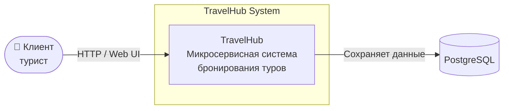
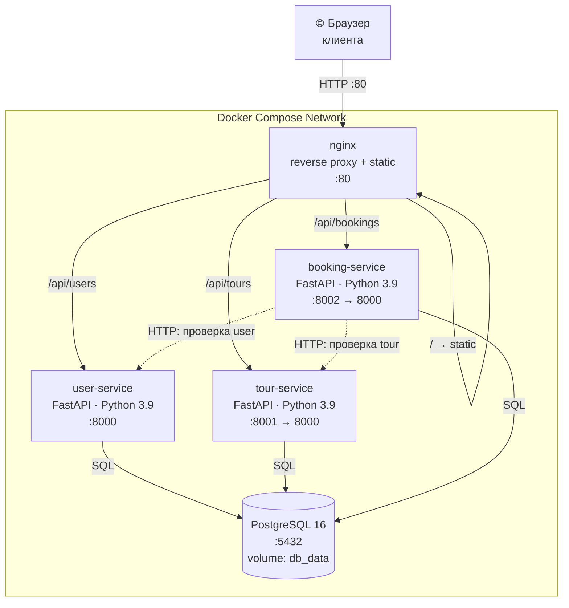

# TravelHub — Архитектура (C4)

Документ описывает архитектуру системы TravelHub по трём уровням модели C4:
**Context**, **Container**, **Component**.

---

## Уровень 1: Context (System Context)

Показывает систему в её окружении — кто её использует и какие внешние системы с ней связаны.



**Что происходит:**

- Клиент (человек) открывает Web UI в браузере
- Web UI обращается к API системы TravelHub
- Система хранит данные в PostgreSQL

---

## Уровень 2: Container

Показывает высокоуровневые технические компоненты системы — сервисы, базы данных, frontend, reverse proxy.



**Контейнеры:**

| Контейнер | Технология | Порт | Назначение |
|---|---|---|---|
| **nginx** | nginx:1.27-alpine | 80 | Reverse proxy + раздача статики фронтенда |
| **user-service** | FastAPI + Uvicorn, Python 3.9 | 8000 | CRUD пользователей |
| **tour-service** | FastAPI + Uvicorn, Python 3.9 | 8001 → 8000 | CRUD туров |
| **booking-service** | FastAPI + Uvicorn, Python 3.9 | 8002 → 8000 | CRUD бронирований + inter-service calls |
| **PostgreSQL** | postgres:16 | 5432 | Общая реляционная БД |

**Поток бронирования:**

1. Браузер → `POST /api/bookings` на nginx
2. nginx проксирует → booking-service
3. booking-service вызывает `GET /users/{id}` на user-service (проверка)
4. booking-service вызывает `GET /tours/{id}` на tour-service (проверка)
5. booking-service сохраняет запись в PostgreSQL
6. Ответ возвращается по цепочке обратно

---

## Уровень 3: Component

Показывает внутреннее устройство одного контейнера. Возьмём **booking-service** как самый интересный (он общается с двумя другими сервисами).

```mermaid
flowchart TB
    subgraph booking-service
        API[FastAPI app<br/>main.py]

        subgraph Endpoints
            POST[/POST /bookings<br/>create_booking/]
            GETL[/GET /bookings<br/>list_bookings/]
            GETO[/GET /bookings/{id}<br/>get_booking/]
        end

        Check[check_exists<br/>HTTP helper]

        DBLayer[get_db_connection<br/>psycopg2]

        Schema[BookingCreate<br/>Pydantic model]
    end

    Client([Браузер / nginx])
    US[user-service]
    TS[tour-service]
    DB[(PostgreSQL)]

    Client --> POST
    Client --> GETL
    Client --> GETO

    POST --> Schema
    POST --> Check
    Check -->|HTTP GET| US
    Check -->|HTTP GET| TS
    POST --> DBLayer
    DBLayer --> DB

    GETL --> DBLayer
    GETO --> DBLayer
```

**Компоненты внутри booking-service:**

| Компонент | Файл / место | Назначение |
|---|---|---|
| FastAPI app | `app = FastAPI(...)` | Точка входа HTTP-сервиса |
| Endpoints | `@app.post`, `@app.get` | 3 endpoint'а: POST, GET (list), GET (by id) |
| `check_exists` | функция | HTTP-клиент к user-service и tour-service |
| `get_db_connection` | функция | Подключение к PostgreSQL через psycopg2 |
| `BookingCreate` | Pydantic-модель | Валидация входящего JSON-тела |

**Жизненный цикл запроса `POST /bookings`:**

1. FastAPI принимает HTTP-запрос
2. Pydantic валидирует body → `BookingCreate(user_id, tour_id)`
3. Endpoint `create_booking` вызывает `check_exists` для user-service → если 404, возвращает 404
4. Вызывает `check_exists` для tour-service → аналогично
5. Открывает соединение с PostgreSQL через `get_db_connection`
6. `INSERT INTO bookings ... RETURNING id` → получает новый ID
7. Возвращает JSON-ответ клиенту

---

## Замечания к архитектуре

**Сильные стороны:**

- Чёткое разделение ответственности: каждый сервис отвечает за свою сущность
- Независимый деплой: можно обновить один сервис без остановки остальных
- HTTP-коммуникация между сервисами (а не shared DB access) → сервисы слабо связаны
- Healthcheck на БД + `depends_on: condition: service_healthy` → корректный порядок старта
- Volume `db_data` → данные сохраняются между перезапусками

**Слабые стороны (что улучшил бы в production):**

- **Общая БД** для всех сервисов — архитектурный запах. Правильнее: database-per-service (каждый сервис имеет свой инстанс или schema)
- **Синхронные HTTP-вызовы** между сервисами — при падении user-service бронирования не работают. Решение: circuit breaker (например, `tenacity` для retry) или event-driven через брокер (Kafka, RabbitMQ)
- **Нет auth** — API открыт. В проде: JWT-auth на gateway
- **Нет HTTPS** — только HTTP. В проде: TLS-терминация на nginx + Let's Encrypt
- **Секреты в открытом виде** (`POSTGRES_PASSWORD: 1234` в docker-compose). В проде: через Docker secrets / Vault / .env не в репо
